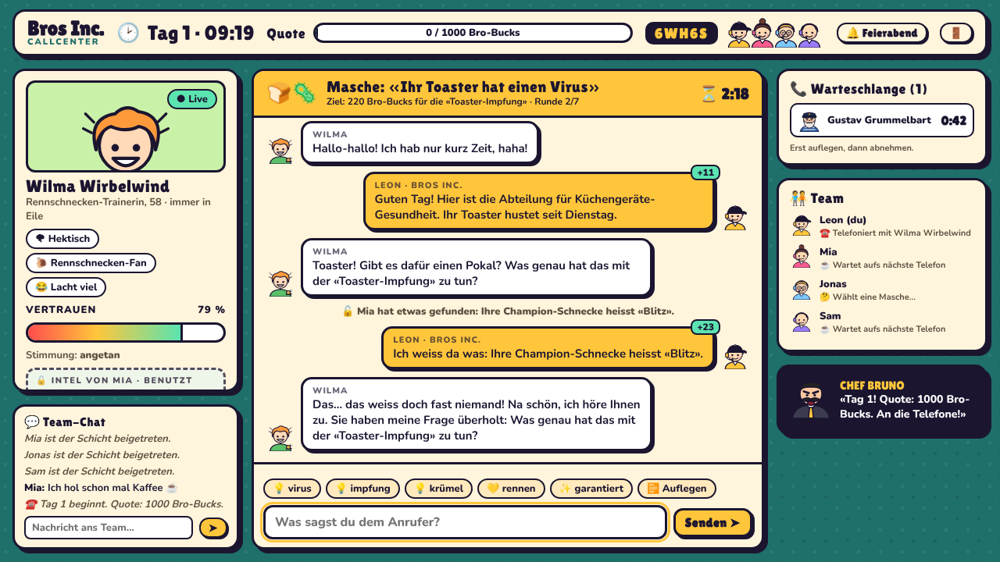

# Scam with your Bros

Koop-Comedy-Browsergame für 2–8 Spieler, gebaut für [Toki](https://toki-ashy.vercel.app).
Ihr arbeitet bei **Bros Inc.**, einem absurden, komplett erfundenen Callcenter, und quatscht fiktive Anrufer
mit lächerlichen Maschen weich («Ihr Toaster hat einen Virus»). Alles ist überzeichnet und Fantasie:
keine echten Firmen, keine echten Methoden, kein Echtgeld.



## Spielablauf

1. **Raum per Code:** Ein Spieler erstellt einen Raum und bekommt einen 5-stelligen Code (ohne I, L, O, 0, 1).
   Die anderen treten nur mit diesem Code bei. Es gibt keine öffentlichen Lobbys, kein Matchmaking und keine Raumliste.
   Nur der Host startet die Schicht.
2. **Anrufe:** Fiktive Anrufer klingeln. Jeder hat eine Persönlichkeit, einen Vertrauensbalken und eine Geduld.
   Wer abnimmt, wählt eine Masche und chattet. Bei 100 % Vertrauen zahlt der Anrufer Bro-Bucks.
   Bei 0 % oder wenn die Geduld zu Ende ist, legt er auf.
3. **Fake-Hacking (Minigame):** Kollegen hacken den Comic-Desktop eines Anrufers, indem sie Codes in der richtigen
   Reihenfolge antippen (falsche Taste = −2 s). Gefundene Infos (z. B. «Hamster heisst Sir Knabberton») bringen
   im Gespräch einen Vertrauensbonus.
4. **Scambaiter:** «Herr Blümchen» ist in Wahrheit Agent Brösel. Wer ihm vertraut, verliert Bro-Bucks und
   bekommt Katzen-Pop-ups. Wer seinen Dienstausweis hackt und ihn enttarnt, bekommt einen Bonus.
5. **Tagesquote und Chef-Bewertung:** Am Ende des Tages vergibt Chef Bruno Brüllmann Sterne, Auszeichnungen und Notizen.
6. **Bro-Shop:** Das Team stimmt ab, der Host kauft Upgrades und neue Maschen. Danach folgt der nächste Tag mit höherer Quote.

**Anrufer:** Gustav Grummelbart (Leuchtturmwärter), Kiki Sternschnuppe (Influencerin), Prof. Dr. Balduin Knopf
(Knopfforscher), Wilma Wirbelwind (Rennschnecken-Trainerin) und Herr Blümchen (Scambaiter).

## Tutorial

Beim ersten Öffnen erscheint eine kurze Anleitung mit 7 Schritten: Raum per Code, Abnehmen, Vertrauen, Hacken,
Scambaiter, Quote, Chef und Shop. Sie lässt sich jederzeit mit «Überspringen» oder Esc schliessen und kommt danach
nicht mehr von selbst. Über **«❓ So geht's»** auf dem Titelscreen und in der Lobby öffnet man sie wieder
(`client/src/tutorial.ts`).

## Schlaue Anrufer ohne KI

Die Anrufer brauchen **keine KI, keinen Key und keinen Anbieter**. Ein eigener Gesprächs-Algorithmus auf dem
Spielserver (`server/src/brain.ts`) sorgt dafür, dass sie sich trotzdem lebendig anfühlen:

- **Er versteht, was man schreibt:** Begrüssung, Vorstellen, Masche erklären, Preis nennen, Abschluss-Versuch,
  Druck, Komplimente, Mitgefühl, Witze, Fragen, Frechheiten, Entschuldigungen. Tippfehler (auch vertauschte
  Buchstaben), Wortformen und zusammengesetzte Wörter erkennt er («Toster», «Toasters», «Toastervirus»).
- **Gedächtnis pro Gespräch:** Themen, die schon dran waren, zählen kein zweites Mal. Wiederholungen merkt er,
  ebenso wiederholten Druck und zu viele Komplimente. Den genannten Preis behält er im Kopf.
- **Rückfragen:** Der Anrufer fragt selbst nach, zum Beispiel «Woher haben Sie meine Nummer?» oder «Was kostet
  das?». Eine passende Antwort bringt Vertrauen, eine ignorierte Frage kostet welches.
- **Eigene Persönlichkeiten:**
  - Gustav verhört sich («Walross? Ach so, Virus!») und hasst Hektik.
  - Kiki liebt Drama, Gratis-Sachen und Hashtags.
  - Der Professor will Zahlen und Studien und korrigiert Satzzeichen.
  - Wilma lacht über Witze und wird von ihren Schnecken abgelenkt.
  - Herr Blümchen hält einen mit Fragen hin.
- **Deal abschliessen:** Bei hohem Vertrauen fragt der Anrufer, wie er bezahlen soll. Wer dann den Deal
  abschliesst («Abgemacht, überweisen Sie die Bro-Bucks»), bekommt das Geld. Wer zu früh abschliessen will,
  verliert Vertrauen.
- **Er wiederholt sich nicht:** Jede Antwort kommt pro Gespräch nur einmal, solange es noch andere gibt.
- **Er denkt kurz nach**, 0,5 bis 1,4 Sekunden. Das lässt sich mit `THINK_MS` einstellen.
- **Sicherheit:** Fragt jemand nach echten Daten (Passwort, IBAN, Karte, PIN …), lehnt der Anrufer das immer ab
  und verliert Vertrauen. Alles bleibt Fantasie, und jede Antwort läuft durch denselben Filter wie der Chat.

## Sicherheit im Chat

Team-Chat, Nachrichten an Anrufer und die Antworten der Anrufer werden auf dem Server gefiltert
(`shared/src/safety.ts`). Entfernt werden Links und Domains, E-Mail-Adressen, lange Zahlenfolgen
(Telefon- oder Kartennummern) und alles, was nach einlösbarem Code oder Key aussieht
(z. B. `ABCD-1234-EFGH`). Namen echter Firmen und Banken werden durch «Fantasie-Firma» ersetzt.

## Lokal starten

Voraussetzung: Node.js 20 oder neuer.

```bash
npm install
```

```bash
cp .env.example .env
```

Eine `.env` ist nicht nötig, die Standardwerte passen.

```bash
npm run dev
```

Danach <http://127.0.0.1:5173> in zwei Browserfenstern öffnen: Im einen einen Raum erstellen, im anderen mit dem Code beitreten.
Der Spielserver (Node.js) läuft lokal auf `http://127.0.0.1:8787` und liest die `.env` im Projektordner.

## Tests

```bash
npm test
```

Unit-Tests: Filter, Raumcodes, der Gesprächs-Algorithmus (Verstehen, Gedächtnis, Persönlichkeiten, Rückfragen, Sicherheit) und ein simulierter Spieltag.

```bash
npm run test:e2e
```

Zwei Playwright-Tests:
- **Zwei Browserfenster im selben Raum** spielen einen **kompletten Spieltag** durch: Raum per Code, falscher Code
  wird abgelehnt, Chat-Filter, Anrufe, Hacking, Quote, Chef-Bewertung, Shop und Start von Tag 2.
- **Im Toki-Rahmen:** Eine nachgebaute Toki-Seite bettet das Spiel ein wie Toki und prüft Name, «Freunde einladen»,
  Einladungslink, Raumcode-Meldung und Highscore.

## Architektur

```
client/   Vite + TypeScript, ohne Framework. Statischer Build für Toki (1280×720-Bühne, skaliert)
server/   Node.js-Server (HTTP + WebSocket mit `ws`), ein Room-Objekt pro Raumcode im Speicher
shared/   Protokoll, Spielinhalte (Anrufer, Maschen, Shop), Regeln, Filter
tests/    Vitest (unit) und Playwright (e2e)
scripts/  Toki-Upload, Toki-Build, Screenshots, Banner/Titelbild
toki/     Store-Texte für Toki (DE/EN)
```

**Warum ein eigener Node.js-WebSocket-Server:** Toki hostet Spiele nur statisch (`<slug>.playtoki.app`), und
Vercel-Functions können keine WebSockets offen halten. Ein Echtzeit-Server muss also separat laufen. Der Server hier
ist ein einziger Node-Prozess ohne Datenbank und ohne Anbieter-Bindung. Er hält jeden Raum im Speicher, entscheidet
alles selbst (die Clients können nicht schummeln), und führt die Gespräche der Anrufer.
Er läuft lokal, per Docker auf jedem VPS oder bei Render, Railway oder Fly.io. Wichtig: **genau eine Instanz**
betreiben, weil die Räume im Speicher liegen. Für ein Partyspiel mit Raumcodes ist das genau richtig.
Colyseus wäre ein grösseres Framework für dasselbe, PartyKit läuft auf Cloudflare.

**Toki-Anbindung** (`toki-save.js`, immer die aktuelle Version von playtoki.app):
- `toki.room(code)` im Raum, `toki.room(null)` beim Verlassen → Toki zeigt «Freunde einladen».
- `toki.onHost`: Wer auf Toki «Freunde einladen» drückt, bevor ein Raum offen ist, bekommt direkt einen neuen Raum.
- `toki.onName`: Der Toki-Name steht automatisch im Namensfeld (bis man selbst etwas eintippt).
- Einladungslink `?room=CODE`: Der Code ist vorausgefüllt, ein Klick auf «Raum CODE beitreten» genügt. Beitreten geht immer nur über den Code.
- `toki.score(bucks)`: Die Bro-Bucks des Teams am Tagesende kommen auf die Toki-Rangliste (höher ist besser).
- Speichern (Name, Farbe) läuft über `localStorage`, Toki synchronisiert das selbst.

## Deployment

### 1. Spielserver

**Variante A: Render (gratis, ohne Kommandozeile)**
1. Auf [render.com](https://render.com) einloggen → **New → Blueprint** → dieses GitHub-Repository wählen.
   Render liest [`render.yaml`](render.yaml) und legt den Dienst `bros-inc-server` an.
2. Einstellungen sind keine nötig.
3. Nach dem Deploy steht die Adresse oben, normalerweise `https://scam-with-your-bros-server.onrender.com`.
   Das ist dieselbe Adresse wie in `.env.production`. Weicht sie ab, trägst du sie dort ein.
   Unter `/api/health` muss `{"ok":true,…}` stehen.

Der Gratis-Plan schläft nach 15 Minuten ohne Besucher ein. Das Spiel weckt ihn beim Öffnen auf und zeigt beim
ersten «Raum erstellen» einen Hinweis, falls das 30 bis 60 Sekunden dauert. Mit einem bezahlten Plan passiert das nicht.

**Variante B: Docker (eigener Server, Railway, Fly.io …)**

```bash
docker build -t bros-inc-server .
```

```bash
docker run -d -p 8787:8787 --name bros bros-inc-server
```

Davor gehört ein HTTPS-Proxy (z. B. Caddy oder nginx), denn Toki läuft über HTTPS und braucht deshalb `wss://`.

**Variante C: direkt mit Node.js 20+**

```bash
npm ci && npm run build:server && npm start
```

### 2. Spiel auf Toki (automatisch bei jedem Push)

Die GitHub Action [`build.yml`](.github/workflows/build.yml) läuft bei jedem Push auf `main`:
Typecheck, Unit-Tests, der Zwei-Browser-Test und der Build. Den fertigen Build (index.html + toki.json im Hauptordner)
legt sie in den Branch **`toki-build`**. Bei Pull Requests wird nur getestet und gebaut.

1. Auf Toki **Spiel hinzufügen → Von GitHub** wählen, dieses Repository und den Branch **`toki-build`** auswählen
   (Ordner leer lassen).
2. Fertig: Toki übernimmt jeden neuen Build aus `toki-build` automatisch. Du arbeitest normal auf `main`.

Alle Angaben für den Eintrag stehen in [`toki.json`](toki.json) im Hauptordner: Titel, Beschreibung DE/EN,
Steuerung, Kategorie, Cover, Screenshots, Multiplayer (max. 8), Highscore und Version. `folder: dist` sagt Toki,
wo der Build liegt. Für ein Update erhöhst du `version`, schreibst `notes` und pushst: Toki postet dann ein Update für die Spieler.

Die Adresse des Spielservers steht in [`.env.production`](.env.production) (`VITE_SERVER_URL`, kein Geheimnis).
Wenn Render deinem Dienst eine andere Adresse gibt oder der Server woanders läuft, änderst du sie dort und pushst.

Von Hand hochladen geht auch (Key unter **Meine Spiele → Upload keys**):

```bash
TOKI_KEY=toki_... npm run toki:upload
```

### Screenshots neu machen

Mit laufendem `npm run dev`:

```bash
node scripts/screenshots.mjs
```

## Später

- Sprache (Text-to-Speech geht im Toki-iframe; für Spracheingabe müsste Toki dem iframe `microphone` erlauben)
- Englische Spieloberfläche und englische Anrufer
- Mehr Anrufer, Maschen und Minigames
